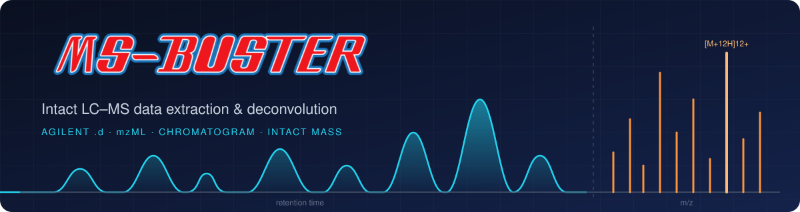
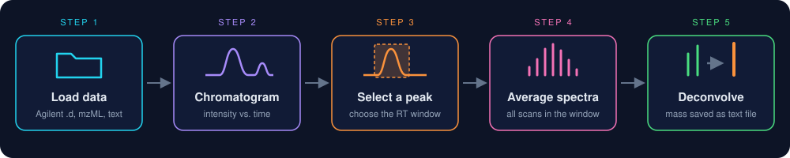
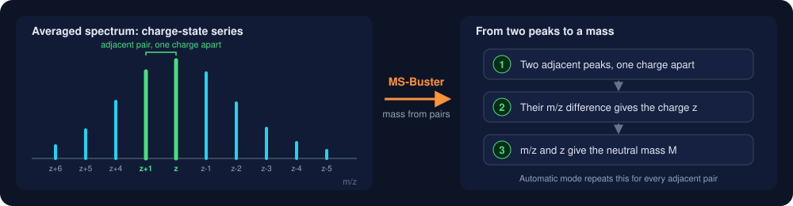

<div align="center">



<br>


<p>
  <a href="#-about">About</a> ·
  <a href="#-workflow">Workflow</a> ·
  <a href="#-features">Features</a> ·
  <a href="#-how-the-deconvolution-works">Deconvolution</a> ·
  <a href="#-installation">Installation</a> ·
  <a href="#-usage">Usage</a>
</p>

</div>

---

## 🧪 About

<table>
<tr>
<td valign="middle">

**MS-Buster** (Mass Spectrometry Buster) is a Python tool for extracting and deconvolving **intact LC-MS** data. It was built for the **CBT group at IIT Delhi** to process antibody data from an **Agilent 6545 Q-TOF** LC-MS system, and it is designed to be used by researchers **without programming experience**.

With MS-Buster you can explore a chromatogram interactively, pick a peak, extract and average the mass spectra under it, and calculate the **intact mass** of the molecule, all in one workflow.

</td>
<td align="center" width="320">


</td>
</tr>
</table>

### Why it exists

Agilent instruments store each run as a **`.d` folder** whose experiment data sits in binary files. These are normally opened with commercial software or third-party tools that can take a long time to process. MS-Buster reads the `.d` folder directly in Python, so the whole analysis, from raw data to a mass estimate, runs in one place.

---

## 🔬 Workflow

<div align="center">

</div>

1. **Load data.** Open an Agilent `.d` folder, an mzML file, or a plain-text file.
2. **Chromatogram.** MS-Buster plots intensity against retention time.
3. **Select a peak.** Drag a span selector over the chromatographic peak of interest. The start and end times define a retention-time window.
4. **Average spectra.** All mass spectra inside the window are extracted and averaged, then shown in a second graph that has its own span selector.
5. **Deconvolve.** Calculate the intact mass in manual or automatic mode. Every result is saved as a text file.

---

## ✨ Features

| | Feature | Description |
|---|---|---|
| 📂 | **Agilent `.d` parsing** | Reads the binary `.d` folders using the [`multiplierz`](https://github.com/BlaisProteomics/multiplierz) library and organises the data into readable arrays |
| 📄 | **Open formats** | Also reads mzML (the standard open format) and plain-text files |
| 📈 | **Interactive chromatogram** | Plots intensity vs retention time, and a matplotlib span selector lets you choose the peak directly on the plot |
| 🧮 | **Spectrum averaging** | Extracts every spectrum in the selected window and averages them into one m/z spectrum |
| ✋ | **Manual deconvolution** | Select two adjacent peaks from one charge-state series to get the intact mass |
| 🤖 | **Automatic deconvolution** | Enter the approximate peak spacing and MS-Buster detects peaks, assigns charge states and flags likely mass candidates |
| 💾 | **Saved results** | Every result is written to a text file for later checking |
| 🖥️ | **Graphical interface** | No scripting needed |

---

## 🧬 How the deconvolution works

Intact proteins such as antibodies appear in an electrospray spectrum as a **series of peaks**, one for each charge state. MS-Buster gives you two ways to turn that series into a mass. Both are meant as a **quick, transparent estimate**, so you can always see how the number was obtained.

<div align="center">

</div>

### Manual mode

Select **two adjacent peaks** from the same charge-state series of one intact molecule. If the two peaks differ by one charge, MS-Buster calculates their charge states from the m/z difference and then the neutral molecular mass from the m/z values.

### Automatic mode

Enter the **approximate peak spacing** you see in the charge-state series. MS-Buster then:

1. detects the peaks,
2. assigns a charge state to each,
3. flags consecutive peaks that differ by exactly one charge (shown in **green**) as likely mass candidates, and
4. calculates a mass from each pair.

You can then compare the independent mass estimates across the series and judge how consistent they are.

<!-- TODO (optional): add a screenshot of the GUI showing the green-flagged peaks, e.g.  -->

---

## ✅ Result

On **intact monoclonal antibody** data, the masses from MS-Buster matched those from Agilent's **BioConfirm**, and the analysis was considerably faster.

---

## 🚀 Installation

**Requirements:** Windows, Python 3.9 and Git.

**1. Clone the repository**

```
git clone https://github.com/kukretiaditya/MS-Buster.git
cd MS-Buster
```

**2. Create and activate a virtual environment**

```
python -m venv msbuster
msbuster\Scripts\activate
```

**3. Install the dependencies**

```
pip install -r requirements.txt
```

---

## 🕹️ Usage

Start the application from the `MS-Buster` folder, with the environment activated:

```
python launcher.py
```

Then follow the [workflow](#-workflow) above: load your data, select the peak of interest on the chromatogram, select the region of the averaged spectrum you want, and run manual or automatic deconvolution. The results are saved as text files.

<!-- TODO: add the exact button/menu names from your GUI, and where the output text files are saved. -->

---

## 📁 Project structure

```
MS-Buster/
├── launcher.py          # Starts the application
├── Deconvoluter.py      # GUI and deconvolution
├── mzML.py              # mzML reading and spectrum handling
├── peptidemapping.py    # Additional module (not part of the workflow described above)
├── requirements.txt     # Python dependencies
├── cbt.ico              # Application icon
└── assets/              # Images used in this README
```

<!-- TODO: confirm the one-line description of each file, especially peptidemapping.py. -->

---

## 🧰 Built with

| Purpose | Library |
|---|---|
| Parsing Agilent `.d` folders | `multiplierz` |
| Interactive plots and span selectors | `matplotlib` |
| File reading and numerics | `pymzml`, `numpy`, `scipy`, `pandas` (see `requirements.txt` for the full list) |
| Interface | `tkinter` |

---

## 🔭 Future work

The next step I explored was **machine-learning approaches to de novo peptide sequencing** from data-independent acquisition (DIA) data, which infer sequences directly from fragment spectra instead of matching them against libraries or databases, with a longer-term goal of extending such approaches to fragmentation spectra of **oligonucleotides**. This is **not implemented** in MS-Buster yet.

---

<details>
<summary><b>🛠️ Troubleshooting</b></summary>

<br>

- **`pip install` fails:** Check that you are using Python 3.9 and that the virtual environment is activated (the prompt should start with `(msbuster)`).
- **Import errors mentioning `pubsub`:** The environment contains both `pubsub` and `Pypubsub`. Try `pip uninstall pubsub` and run again.
- **The program does not start:** Run `python launcher.py` from a terminal to see the full error message.

</details>

---

<div align="center">


[github.com/kukretiaditya](https://github.com/kukretiaditya)

</div>
